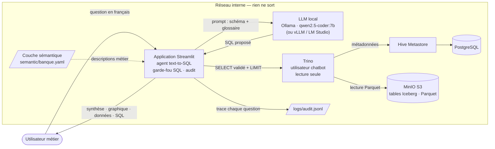

# RK Data — Chat avec votre Lakehouse

POC **100 % on-premise** : vos métiers interrogent le lakehouse **en français**, un LLM hébergé chez vous traduit la question en SQL, la requête est exécutée **en lecture seule** sur Trino / Iceberg, et la réponse revient sous forme de synthèse, de graphique, de données exportables et de SQL vérifiable.

Aucune donnée ne quitte votre réseau : ni les questions, ni le schéma, ni les résultats.

> Démonstration sur une banque de détail marocaine **fictive** (25 agences, 2 000 clients, 3 010 comptes, 30 000 transactions, 800 crédits — montants en MAD).

## Architecture



| Service | Rôle | Image |
|---|---|---|
| `minio` + `minio-init` | Stockage objet S3, création du bucket `warehouse` | MinIO (build Chainguard) |
| `postgres` | Base du Hive Metastore | `postgres:16` |
| `hive-metastore` | Catalogue des tables Iceberg | `apache/hive:4.0.1` + pilotes JDBC / S3 |
| `trino` | Moteur SQL, catalogue `iceberg`, contrôle d'accès par fichier | `trinodb/trino:484` |
| `seed` | Charge les données de démo via le CLI Trino (utilisateur `admin`) | `trinodb/trino:484` |
| `ollama` + `ollama-pull` | LLM local et téléchargement du modèle | `ollama/ollama` |
| `app` | Interface de chat (port 8501), connectée à Trino en tant que `chatbot` | `python:3.12-slim` |

## Démarrage rapide

Prérequis : Docker Desktop (ou Docker Engine + Compose v2), environ 12 Go de disque, 16 Go de RAM conseillés.

```bash
cp .env.example .env            # mots de passe de démonstration, versions, ports
docker compose up -d --build    # premier lancement : images + modèle (~4,7 Go)
docker compose ps -a            # les jobs minio-init, seed et ollama-pull finissent en « Exited (0) »
```

Puis ouvrir **http://localhost:8501**.

Questions à essayer, dans cet ordre :

1. `Quel est le taux d'impayés par région ?`
2. `Évolution mensuelle du flux net en 2026`
3. `et seulement pour Casablanca-Settat ?` (relance : l'assistant repart de la requête précédente)

Suivre le démarrage :

```bash
docker compose logs -f hive-metastore trino seed ollama-pull
```

### Choisir le serveur LLM

Le fichier `.env` pilote tout, sans toucher au code.

| Cas | Réglages dans `.env` |
|---|---|
| Ollama en conteneur (défaut) | `COMPOSE_PROFILES=ollama` · `LLM_BASE_URL=http://ollama:11434` |
| Ollama en conteneur **avec GPU NVIDIA** | en plus : `COMPOSE_PATH_SEPARATOR=,` · `COMPOSE_FILE=docker-compose.yml,docker-compose.gpu.yml` |
| Ollama déjà installé sur le poste | `COMPOSE_PROFILES=` · `LLM_BASE_URL=http://host.docker.internal:11434`, puis `ollama pull qwen2.5-coder:7b` |
| Serveur compatible OpenAI (vLLM, LM Studio…) | `LLM_PROVIDER=openai` · `LLM_BASE_URL=http://serveur:8000/v1` · `LLM_MODEL=…` · `COMPOSE_PROFILES=` |

Après une modification : `docker compose up -d`.

Ordre de grandeur mesuré avec le modèle 7B sur un GPU grand public (RTX 5070 Ti) : **2 à 3 secondes par question**, génération du SQL, exécution et synthèse comprises. Le modèle est préchargé à l'ouverture de la page, pour que la première question ne paie pas son chargement. Sans GPU, prévoir nettement plus (non mesuré ici).

### Bon à savoir

- **Redémarrages** : après le premier lancement, utiliser `docker compose up -d` sans `--build`. Avec `--build`, Docker régénère les images et recrée le metastore et l'application, même si rien n'a changé.
- **Images MinIO** : MinIO ne publie plus d'images officielles sur Docker Hub. Le POC utilise les builds Chainguard ; pour une autre source (registre interne), changer `MINIO_IMAGE` et `MC_IMAGE` dans `.env`.
- **Ports** : Trino (8080) et MinIO (9000, 9001) ne sont publiés que sur `127.0.0.1` ; l'interface (8501) est accessible depuis le réseau. Le metastore et PostgreSQL ne sont pas exposés. Tous les ports se changent dans `.env`.
- **Ollama du poste** : sous Docker Desktop, `host.docker.internal` atteint l'Ollama de Windows ou de macOS sans réglage supplémentaire. Sous Linux, lancer Ollama avec `OLLAMA_HOST=0.0.0.0`.

### Données de démonstration

```bash
python -m venv .venv && .venv/Scripts/activate      # Linux/macOS : source .venv/bin/activate
pip install -r requirements-dev.txt
python scripts/generate_data.py                      # déterministe (graine 42)
```

Le script produit `infra/seed/seed_trino.sql` (chargé par le job `seed`) et `data/banque.db` (copie SQLite). Les deux fichiers sont déjà fournis : cette étape n'est utile que si vous modifiez le générateur ou la couche sémantique. Pour recharger Trino ensuite : `FORCE_SEED=1 docker compose up -d seed`.

## Mode hors-ligne (sans Docker)

Pour une démonstration sur un simple portable ou pour développer, l'application tourne sur la copie SQLite, sans MinIO, ni Hive, ni Trino. Seul un serveur LLM local est nécessaire.

```bash
pip install -r requirements.txt
# PowerShell : $env:DB_BACKEND = "sqlite" ; $env:LLM_BASE_URL = "http://localhost:11434"
DB_BACKEND=sqlite LLM_BASE_URL=http://localhost:11434 streamlit run app/ui.py
```

Le fichier SQLite est attaché en lecture seule sous le nom `banque` : les requêtes s'écrivent `banque.table`, comme `iceberg.banque.table` côté Trino. Le prompt s'adapte au dialecte.

### Tests

```bash
pip install -r requirements-dev.txt
pytest tests -q
```

59 tests, hors-ligne, en moins d'une seconde : SQLite réel et LLM factice aux réponses scriptées. Ils couvrent le garde-fou SQL, le verrou lecture seule du fichier, le chemin nominal, l'auto-correction, le blocage des écritures, le hors-périmètre, les formules de politesse, les relances et le choix du graphique.

## Sécurité

**1. Un LLM on-premise.** Le modèle tourne sur votre infrastructure (Ollama, vLLM, LM Studio). Aucun appel à une API externe, aucune télémétrie, aucune police ni script chargé depuis Internet : contrôlé dans un navigateur, l'interface n'émet aucune requête hors de `localhost`. Le LLM ne voit que le schéma, le glossaire et les 30 premières lignes du résultat ; il n'a aucun accès direct à la base.

**2. Deux verrous « lecture seule » indépendants.**

| Verrou | Où | Ce qu'il fait |
|---|---|---|
| Garde-fou applicatif | `app/sql_guard.py` | Une seule requête, commençant par `SELECT` ou `WITH` ; refus de tout mot-clé d'écriture ou de DDL (`INSERT`, `UPDATE`, `DELETE`, `MERGE`, `DROP`, `CREATE`, `ALTER`, `TRUNCATE`, `GRANT`…), en ignorant chaînes et commentaires |
| Droits du moteur | `infra/trino/rules.json` | L'application se connecte en tant que `chatbot`, **read-only** sur le catalogue `iceberg`. Même si le premier verrou était contourné, Trino refuse l'écriture |

Vérification du second verrou :

```bash
docker compose exec trino trino --user chatbot --execute "SELECT count(*) FROM iceberg.banque.credits"
#  -> "800"
docker compose exec trino trino --user chatbot --execute "DELETE FROM iceberg.banque.credits"
#  -> Access Denied: Cannot delete from table iceberg.banque.credits
```

En mode hors-ligne, le second verrou est l'ouverture du fichier SQLite en `mode=ro`.

**3. Des limites.** Nombre de lignes plafonné (`MAX_ROWS=200`, par ajout ou réduction du `LIMIT` final), durée d'exécution bornée (`QUERY_TIMEOUT_S=30`, appliquée par Trino lui-même), 2 tentatives d'auto-correction au maximum.

**4. Un journal d'audit.** Chaque question est tracée dans `logs/audit.jsonl` : utilisateur, question, SQL (y compris les requêtes refusées), nombre de lignes, tentatives, erreur, modèle, temps de réponse.

```json
{"ts": "2026-11-22T09:40:08+00:00", "user": "demo", "question": "Quel est le taux d'impayés par région ?", "status": "ok", "sql": "SELECT a.region, ...", "rows": 9, "attempts": 1, "error": null, "model": "qwen2.5-coder:7b", "backend": "trino", "timings": {"llm_sql_s": 1.8, "sql_s": 0.71, "llm_synthese_s": 0.47, "total_s": 2.99}}
```

**5. Des réponses qui ne trompent pas.** Un petit modèle peut se tromper ; le POC est construit pour que l'erreur se voie plutôt que de passer pour une réponse.

- Le SQL exécuté est toujours affiché, avec le nombre de tentatives.
- La synthèse ne calcule rien : maximum, minimum, première et dernière valeur sont calculés par le code et fournis au modèle, qui se contente de les citer.
- Une question sans réponse dans les données est déclinée (`HORS_PERIMETRE`) au lieu d'être forcée.
- « Bonjour », « merci », « que sais-tu faire ? » sont reconnus par le code, sans appel au modèle : une formule de politesse ne déclenche jamais de requête.
- Si le modèle recopie un exemple ou la requête d'une question précédente pour un message sans rapport, elle est refusée : elle s'exécuterait sans erreur mais répondrait à côté.

**Limites assumées du POC.** Trino est exposé en HTTP sans authentification (port lié à `127.0.0.1`), l'interface n'a pas de connexion utilisateur, les mots de passe du `.env.example` sont des valeurs de démonstration. Voir « Prochaines étapes ».

## Adapter à un client

Tout le savoir métier tient dans **un seul fichier** : `semantic/banque.yaml`. Il alimente à la fois les `COMMENT` des tables Iceberg, le prompt du LLM et les questions d'exemple de l'interface.

| Section du YAML | Contenu |
|---|---|
| `contexte` | Périmètre, unités, période couverte |
| `tables` | Description de chaque table et de chaque colonne, avec les valeurs possibles |
| `relations` | Jointures autorisées |
| `glossaire` | Définitions métier : encours, taux d'impayés, client actif, flux net, collecte |
| `exemples` | Couples question → SQL (few-shot), avec le placeholder `{schema}` |
| `questions_suggerees` | Les 6 questions cliquables de la barre latérale |

Pour brancher le POC sur les données d'un client :

1. **Pointer Trino sur son lakehouse** : adapter `infra/trino/catalog/iceberg.properties` (metastore, S3), ou ajouter un catalogue, puis régler `TRINO_CATALOG` et `TRINO_SCHEMA`. Le job `seed` et MinIO deviennent inutiles.
2. **Créer un utilisateur read-only** restreint aux schémas exposés, dans `rules.json` (ou via Ranger / OPA).
3. **Décrire le domaine** dans un nouveau YAML (`SEMANTIC_FILE=semantic/client.yaml`). Le schéma physique est lu par introspection ; le YAML n'apporte que le sens.
4. **Tester 20 à 30 questions réelles** avec les métiers et enrichir glossaire et exemples : c'est ce qui fait la qualité des réponses, bien plus que le choix du modèle.

**Demain, depuis OpenMetadata.** Ce YAML est un format pivot volontairement simple. Dans un SI qui dispose d'un catalogue de données, il se génère automatiquement : descriptions de tables et de colonnes, termes du glossaire et liens de lignage sont exposés par l'API d'OpenMetadata. La gouvernance existante devient ainsi la source de vérité du chatbot, sans double saisie.

## Structure du projet

```
app/            config.py · db.py · sql_guard.py · semantic.py · llm.py · agent.py · ui.py
semantic/       banque.yaml — la couche sémantique
scripts/        generate_data.py — données de démo déterministes
infra/hive/     image du Hive Metastore + hive-site.xml
infra/trino/    catalogue Iceberg + règles d'accès
infra/seed/     seed_trino.sql (généré)
data/           banque.db (généré, mode hors-ligne)
tests/          tests hors-ligne
logs/           audit.jsonl
```

## Prochaines étapes

- **Authentification** : SSO de l'entreprise (OIDC / LDAP) devant l'interface, identité propagée dans l'audit (l'en-tête `X-Forwarded-User` est déjà lu) et jusqu'à Trino.
- **Sécurité fine** : TLS et authentification sur Trino, droits par ligne et par colonne, masquage des données personnelles (Ranger ou OPA), un profil de droits par population d'utilisateurs.
- **Couche sémantique** : génération depuis OpenMetadata, métriques certifiées, synonymes métier.
- **Qualité** : jeu de questions de référence rejoué à chaque changement de modèle ou de prompt, retour utilisateur (pouce haut / bas) pour enrichir les exemples.
- **Modèles** : comparaison de modèles plus grands sur GPU (vLLM), spécialisation éventuelle sur le SQL du client.
- **Exploitation** : audit vers le SIEM, supervision, haute disponibilité, déploiement Kubernetes.

---

RK Data · Casablanca · [rkdata.ma](https://rkdata.ma) · contact@rkdata.ma
